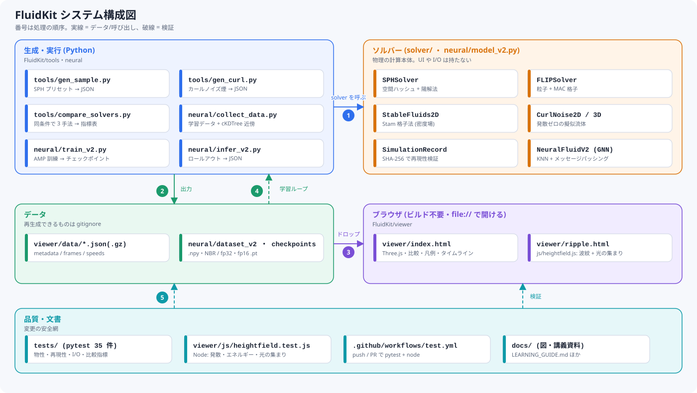
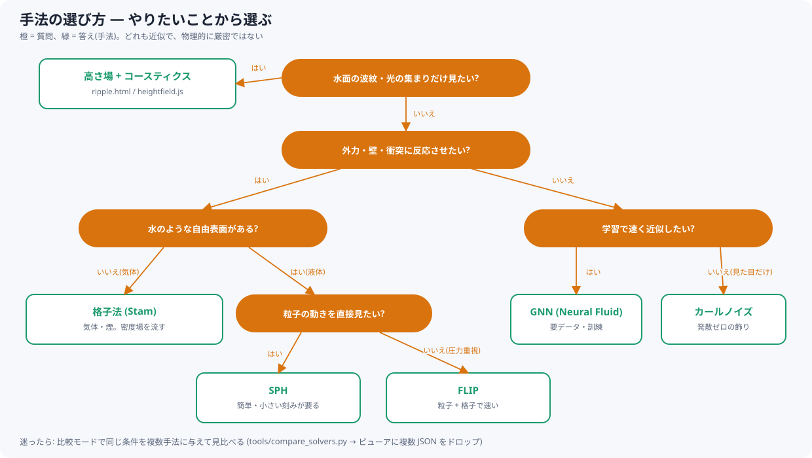
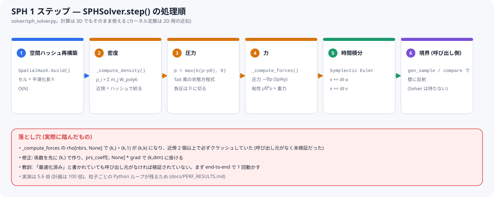
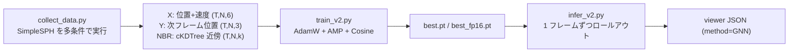
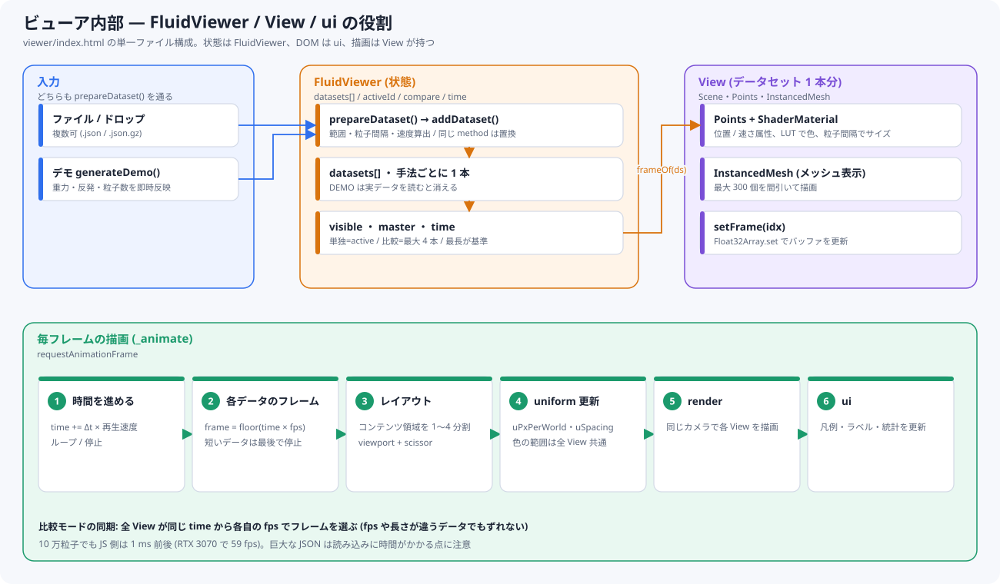
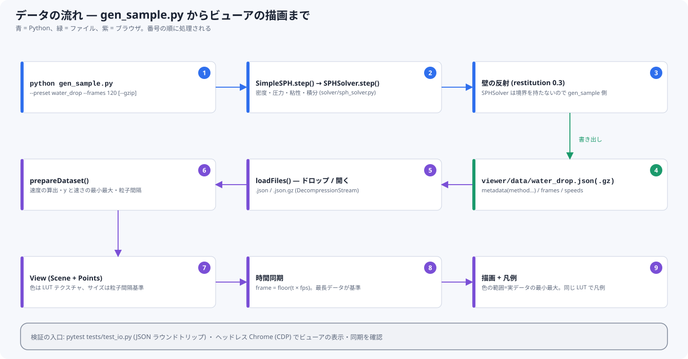

# FluidKit 学習ガイド — 基礎から保守・拡張まで

この資料は、FluidKit を**自分で保守・拡張できるようになる**ための講義資料です。
「流体シミュレーションとは何か」「各アルゴリズムの式とコード」「スクリプトの動かし方」「壊したときの直し方」「新しい手法の足し方」を、
基礎から順に書いています。式は GitHub / VS Code のプレビューで表示されます(LaTeX)。図は `docs/diagrams/` の SVG です。

> **この資料の約束**: コード片は実ファイルから引用しています。引用箇所は `ファイル名` で示すので、迷ったら元ファイルを開いて確認してください。
> 実装は学習用の**近似**であり、物理的に厳密ではありません。

## 目次

| 章 | 内容 | 読む人 |
|---|---|---|
| [0](#0-全体像と読み方) | 全体像・読み方・ディレクトリ地図 | 全員 |
| [1](#1-環境構築と動かし方) | 環境構築・各スクリプトの動作手順 | 全員 |
| [2](#2-流体シミュレーションの基礎) | 連続体・ナビエ–ストークス・粒子法/格子法・時間積分・CFL | 初学者 |
| [3](#3-python--numpy-の基礎-この-repo-で必要な範囲) | ベクトル化・ブロードキャスト・散布・空間ハッシュ | 初学者 |
| [4](#4-sph--solversph_solverpy) | SPH の式とコードの対応 | 中級 |
| [5](#5-格子法-stam--solverstable_fluidspy) | Stam 安定流体(拡散・移流・圧力投影) | 中級 |
| [6](#6-flip--solverflip_solverpy) | 粒子 + 格子のハイブリッド | 中級 |
| [7](#7-カールノイズ--solvercurl_noisepy) | 発散しない速度場 | 中級 |
| [8](#8-波紋の高さ場とコースティクス--viewerjsheightfieldjs) | 波動方程式・CFL の導出・光の集まり | 中級 |
| [9](#9-neural-fluid-gnn) | データ → KNN → メッセージパッシング → 推論 | 中級 |
| [10](#10-データ形式-viewer-json) | JSON の完全仕様 | 保守担当 |
| [11](#11-ビューア-threejs) | Three.js の基礎と本ビューアの構造 | 保守担当 |
| [12](#12-テストと検証の流儀) | 物理不変量テスト・Node テスト・ブラウザ検証 | 保守担当 |
| [13](#13-保守拡張ガイド) | 変更手順・チェックリスト・障害対応・既知の制約 | 保守担当 |
| [14](#14-演習) | 手を動かす課題 | 全員 |
| [15](#15-用語集と参考文献) | 用語・参考文献 | 全員 |

---

## 0. 全体像と読み方

FluidKit は「流体のデータを作り(生成)、物理の計算本体(ソルバー)を呼び、JSON にして、ブラウザで見る」ための道具箱です。



### 0.1 読む順番

- **まず動かす**: 第 1 章 → ビューアで `water_drop.json` を見る。
- **仕組みを知る**: 第 2・3 章(基礎) → 第 4〜8 章(手法)。
- **直す・足す**: 第 10〜13 章。

### 0.2 ディレクトリ地図

```
LearningFluidEngine/
├── FluidKit/
│   ├── solver/            物理の計算本体 (UI も I/O も持たない)
│   │   ├── sph_solver.py       SPH (空間ハッシュ)
│   │   ├── flip_solver.py      FLIP (粒子 + MAC 格子)
│   │   ├── stable_fluids.py    Stam 格子法
│   │   ├── curl_noise.py       カールノイズ
│   │   ├── reproducibility.py  SHA-256 による再現性検証
│   │   └── runner.py           タイムアウト付きサンドボックス実行
│   ├── tools/             データ生成・変換 (gen_sample / gen_curl / compare_solvers / xyz_to_json …)
│   ├── neural/            Neural Fluid (collect_data → train_v2 → infer_v2, model_v2)
│   ├── viewer/            ブラウザ (index.html, ripple.html, js/heightfield.js)
│   ├── tests/             pytest (35 件)
│   ├── utils.py           正規化/逆正規化の共通関数
│   └── docs/              この資料・図・計測結果
└── .github/workflows/     test.yml (pytest + Node), release.yml (WASM)
```

### 0.3 設計の原則(拡張するときに守る)

1. **ソルバーは計算だけ**。ファイル出力・描画・CLI は `tools/`・`viewer/` に置く(`solver/` は import しただけで副作用が無い)。
2. **生成スクリプトは `metadata.method` を付ける**(ビューアが手法を識別する)。
3. **「動いた」では足りない**。物理の不変量(運動量・境界・発散など)をテストにする(第 12 章)。
4. **数値は測ってから書く**。計画書の「100 倍」は実測 5.6 倍だった(`docs/PERF_RESULTS.md`)。
5. **近似であることを隠さない**。ビューアには「近似であり、物理的に厳密ではありません」を固定表示している。

---

## 1. 環境構築と動かし方

### 1.1 必要なもの

| もの | 用途 | 備考 |
|---|---|---|
| Python 3.12 | ソルバー・生成・テスト | `uv` でも `pip` でも可 |
| numpy, scipy | ソルバー全般(scipy: 格子法・FLIP・cKDTree) | |
| torch | Neural Fluid のみ | GPU(CUDA)があると速い |
| pytest | テスト | |
| Node.js 18+ | `heightfield.js` のテスト | 無ければ該当テストはスキップ |
| Chrome / Edge | ビューア(WebGL2) | インストール不要・ビルド不要 |

```bash
pip install numpy scipy pytest          # ソルバーとテスト
pip install torch                       # Neural Fluid を使うときだけ
# uv を使う場合: uv pip install numpy scipy pytest
```

### 1.2 まず動かす(3 分)

```bash
cd FluidKit/tools
python gen_sample.py --preset water_drop --frames 80         # → ../viewer/data/water_drop.json
```

`FluidKit/viewer/index.html` をブラウザで開き、生成された JSON をドロップする(最初はデモデータが再生される)。

### 1.3 スクリプト別の動作手順

| やりたいこと | コマンド | 出力 |
|---|---|---|
| SPH のサンプル(3 プリセット) | `python tools/gen_sample.py --preset water_drop\|smoke\|splash --frames 120 [--gzip]` | `viewer/data/<preset>.json(.gz)` |
| カールノイズの煙 | `python tools/gen_curl.py --frames 120 --particles 1500 [--gzip]` | `viewer/data/curl_smoke.json` |
| 3 手法の比較 | `python tools/compare_solvers.py --export-viewer --output docs/COMPARE_ATLAS.md` | 指標表 + `viewer/data/compare_{sph,flip,grid}.json` |
| 学習データ | `cd neural && python collect_data.py --simulations 100 --output ./dataset_v2` | `.npy`(位置・速度・近傍) |
| 訓練 | `python train_v2.py --ckpt ./checkpoints_v3 --epochs 120` | `best.pt` / `best_fp16.pt` |
| 推論 | `python infer_v2.py --checkpoint ./checkpoints_v3/best.pt --frames 120` | `viewer/data/neural_v2_*.json` |
| テスト | `pytest FluidKit/tests/ -v` | 35 件 |
| 波紋 | `viewer/ripple.html` をブラウザで開く | — |
| 図の再生成 | `python docs/diagrams/build_diagrams.py` | `docs/diagrams/*.svg` |

比較モードを試す: `compare_solvers.py --export-viewer` のあと、`viewer/index.html` に `compare_*.json` を**まとめてドロップ**し、上の「比較」を押す。

### 1.4 よくあるつまずき

| 症状 | 原因と対処 |
|---|---|
| `ModuleNotFoundError: scipy` | `pip install scipy`(`solver/__init__.py` が scipy を import する) |
| 日本語が文字化け(Windows) | コンソールが cp932。出力ファイルは UTF-8 なので内容は壊れていない。`compare_solvers.py` は stdout を UTF-8 に再設定済み |
| ビューアが真っ黒 | CDN(three.js)に接続できない。ネットワークを確認(three@0.158.0 を jsdelivr から読む) |
| `.json.gz` が開けない | ブラウザが `DecompressionStream` 非対応。最新の Chrome / Edge / Firefox を使う |
| `viewer/data/` が空 | gitignore 対象。上の生成コマンドで再生成する |
| `NBR_train.npy がありません` | 古いデータセット。`collect_data.py` を再実行(近傍の事前計算が追加された) |

---

## 2. 流体シミュレーションの基礎

### 2.1 何を計算するのか

水や煙の動きは、**連続体**として次の**ナビエ–ストークス方程式**で書けます(非圧縮・一様密度の場合)。

$$
\frac{\partial \mathbf{u}}{\partial t} + (\mathbf{u}\cdot\nabla)\mathbf{u} = -\frac{1}{\rho}\nabla p + \nu \nabla^2 \mathbf{u} + \mathbf{g},
\qquad \nabla\cdot\mathbf{u} = 0
$$

| 記号 | 意味 | この repo での扱い |
|---|---|---|
| $\mathbf{u}$ | 速度 | 粒子速度 / 格子の速度場 |
| $p$ | 圧力 | SPH: 状態方程式 / 格子: ポアソン方程式を解く |
| $\rho$ | 密度 | SPH: 粒子から推定 |
| $\nu$ | 動粘性係数 | `viscosity` |
| $\mathbf{g}$ | 外力(重力) | `gravity` |
| $\nabla\cdot\mathbf{u}=0$ | 非圧縮(体積が変わらない) | 格子法・FLIP は圧力投影で課す。SPH は圧縮を許し、状態方程式で戻す |

左辺第 2 項 $(\mathbf{u}\cdot\nabla)\mathbf{u}$ は**移流**(流れが自分自身を運ぶ)、$-\frac1\rho\nabla p$ は**圧力**、$\nu\nabla^2\mathbf{u}$ は**粘性**(拡散)です。
アルゴリズムの違いは、この 3 つ(移流・圧力・粘性)をどう近似するかの違いです。

> 注意: 3 次元ナビエ–ストークス方程式の**解の存在と滑らかさ**は数学の未解決問題で、最近の話題には争点があります。
> このリポジトリは方程式を近似的に解くだけで、理論的な結論を前提にしません(`docs/NOTE_NAVIER_STOKES.md`)。

### 2.2 表現のしかた: オイラー vs ラグランジュ

| | ラグランジュ(粒子) | オイラー(格子) |
|---|---|---|
| 見方 | 流れに乗って動く点 | 固定した格子点で見る |
| 移流 | 粒子を動かすだけ(自然) | 数値拡散が出やすい(セミラグランジュ法で緩和) |
| 圧力・非圧縮 | 近傍から推定(SPH)で扱いづらい | 格子で連立方程式を解ける |
| 自由表面(水面) | 粒子の有無で自然に表現 | 別途レベルセット等が必要 |
| 例 | SPH | Stam 格子法 |
| ハイブリッド | **FLIP**: 粒子で運び、格子で圧力を解く | |

### 2.3 時間積分

位置と速度を $\Delta t$ ずつ進めます。本 repo の SPH は **Symplectic Euler**:

$$
\mathbf{v}_{n+1} = \mathbf{v}_n + \Delta t\,\mathbf{a}_n,\qquad \mathbf{x}_{n+1} = \mathbf{x}_n + \Delta t\,\mathbf{v}_{n+1}
$$

(普通の陽的 Euler は $\mathbf{x}_{n+1}=\mathbf{x}_n+\Delta t\,\mathbf{v}_n$。**更新後の速度**で位置を動かすのがポイントで、振動系でエネルギーが暴走しにくい。)

### 2.4 安定条件(CFL)

陽解法は、1 ステップで情報が進める距離が格子/粒子間隔を超えると発散します。

$$
\Delta t \le C\,\frac{\Delta x}{v_{\max}}\quad(\text{移流}),\qquad
\Delta t \le \frac{\Delta x}{c\sqrt{2}}\quad(\text{2D 波動方程式、第 8 章で導出})
$$

SPH(陽解法)は音速 $c\approx\sqrt{k}$ が大きいほど刻みを小さくする必要があり、`compare_solvers.py` では 0.001 s を使っています。
格子法・FLIP は 0.01 s で動きます(`docs/COMPARE_ATLAS.md` の「ms/シミュ秒」が刻みの違いを吸収したコスト)。

### 2.5 「近似」とは

この repo の手法は次の点で厳密ではありません。ビューアの固定注記もこれに由来します。

- カーネル定数が 2D 用のまま 3D データに使われている(SPH)。
- 壁は反射のみで、床の斥力は無い(SPH)。
- 圧力投影は固定 20 回の反復で、残差が残る(格子法・FLIP)。
- カールノイズ・GNN は方程式を解かない。



---

## 3. Python / numpy の基礎(この repo で必要な範囲)

### 3.1 ベクトル化

Python の `for` で 1 要素ずつ計算すると遅いので、numpy の配列演算にまとめます。`stable_fluids.py` の移流はその典型です。

```python
# stable_fluids.py: _advect — 全格子点を一度に「逆追跡」する
src_i = self._I - dt0 * u          # shape (N+2, N+2)
src_j = self._J - dt0 * v
src_i = np.clip(src_i, 0.5, N + 0.5)
result = map_coordinates(d, [src_i.ravel(), src_j.ravel()], order=1, mode="nearest").reshape(d.shape)
```

### 3.2 ブロードキャスト(今回実際に踏んだバグ)

形の違う配列を演算すると、numpy は軸を右からそろえて 1 の軸を引き延ばします。意図しない形になっても**エラーにならず進む**ことがあります。

```python
import numpy as np
k = 4
a = np.arange(k, dtype=float)          # shape (k,)
b = np.arange(k, dtype=float)[:, None] # shape (k,1)
print((a / b).shape)                   # (4, 4) ← (k,) ÷ (k,1) は (k,k) 行列になる!
```

`sph_solver.py` の `_compute_forces` は、修正前に `mass[nbrs] * prs_avg / rho[nbrs, None]` と書いていて、
$(k,)$ ÷ $(k,1)$ が $(k,k)$ になり、次の $(k,dim)$ との積で `ValueError` になりました(近傍が 2 個以上あると必ず)。

```python
# 修正後 (solver/sph_solver.py)
prs_coeff = mass[nbrs_arr] * prs_avg / rho[nbrs_arr]        # (k,)  ← まず 1 次元で完結させる
prs_force = -(prs_coeff[:, None] * self._W_spiky_grad(r_vecs, rs)).sum(axis=0)   # (k,1)*(k,dim)→(k,dim)
```

**ルール**: `None`(`np.newaxis`)は式の**最後**、配列どうしを掛ける直前にだけ使う。途中に挟まない。
形を疑うときは `print(x.shape)` を各項に入れる。

### 3.3 散布(scatter): `np.add.at`

粒子の値を格子に足し込むとき、同じセルに複数の粒子が入ると `grid[idx] += w` は**最後の 1 つしか足されない**。
`np.add.at(grid, idx, w)` は重複を正しく積算する(`flip_solver.py` の P2G)。

### 3.4 空間ハッシュ(近傍探索)

全ペアの距離を測ると $O(N^2)$。セルの大きさを平滑化長 $h$ にすると、近傍は隣り合う 3×3 セルにしか居ません。

```python
# sph_solver.py: SpatialHash
def _hash(self, cx, cy):
    return (cx * 92837111 ^ cy * 689287499) % self.n_buckets
def build(self, positions):          # O(N): 全粒子を登録
    ...
def query(self, pos, r):             # O(k): 近傍候補を返す (k = 平均近傍数)
    ...
```

注意: ハッシュは x, y だけでセルを決めるので、3D データでは z 方向に離れた粒子も候補に入ります。
候補は後段で**実際の 3D 距離**で絞られる(`r2 < h²`)ため結果は正しいが、効率は落ちます(既知の制約)。

### 3.5 dtype と再現性

`float64` で計算し、保存時に丸める(JSON は小数 4 桁)。再現性の検証は `SimulationRecord` が
状態配列の SHA-256 を記録して行う(`tests/test_reproducibility.py`)。乱数は必ず `seed` を固定する(`random.seed` / `RandomState`)。

---

## 4. SPH — `solver/sph_solver.py`

**Smoothed Particle Hydrodynamics**。流体を質量 $m_j$ を持つ粒子の集まりとみなし、
ある点の量 $A$ を近傍粒子の重み付き和で推定します。

$$
A(\mathbf{x}) \approx \sum_j m_j \frac{A_j}{\rho_j} W(\mathbf{x}-\mathbf{x}_j, h)
$$

$W$ は**カーネル**(滑らかな重み)、$h$ は影響半径(`smoothing_length`)。



### 4.1 カーネル(2D 用の定数)

| 用途 | カーネル | 係数(コード) |
|---|---|---|
| 密度 | Poly6: $W=\frac{4}{\pi h^8}(h^2-r^2)^3$ | `_W_poly6_coeff = 4/(π h^8)` |
| 圧力勾配 | Spiky 勾配: $\nabla W=-\frac{10}{\pi h^5}(h-r)^2\hat{\mathbf r}$ | `_W_spiky_grad_coeff = -10/(π h^5)` |
| 粘性 | Viscosity ラプラシアン: $\nabla^2W=\frac{40}{\pi h^5}(h-r)$ | `_W_visc_lap_coeff = 40/(π h^5)` |

Poly6 は距離の 2 乗だけで計算できる(`sqrt` 不要)ので密度に向く。圧力勾配に使うと粒子が近づいたとき勾配が 0 に潰れるため、Spiky を使う。

### 4.2 密度・圧力・力

1. **密度**: $\rho_i=\sum_j m_j W_{\text{poly6}}(|\mathbf{x}_i-\mathbf{x}_j|)$ (`_compute_density`)
2. **圧力**(状態方程式): $p_i=\max\bigl(k(\rho_i-\rho_0),\,0\bigr)$。$k$=`gas_constant`、$\rho_0$=`rest_density`。負圧は 0 に切る(粒子が引き合って固まるのを防ぐ)
3. **圧力力**: $\mathbf{f}^{p}_i=-\sum_j m_j\frac{p_i+p_j}{2\rho_j}\nabla W_{\text{spiky}}$ — $(p_i+p_j)/2$ で**作用・反作用が対称**になり、内力だけなら運動量が保存される
4. **粘性力**: $\mathbf{f}^{v}_i=\mu\sum_j m_j\frac{\mathbf{v}_j-\mathbf{v}_i}{\rho_j}\nabla^2W_{\text{visc}}$
5. 加速度 $\mathbf{a}_i=\dfrac{\mathbf{f}^p_i}{\rho_i}+\dfrac{\mathbf{f}^v_i}{\rho_i}+\mathbf{g}$

```python
# sph_solver.py: SPHSolver.step — 全体の流れ
self._hash.build(pos)                                       # 1. 空間ハッシュ再構築 O(N)
rho = self._compute_density(pos, mass)                      # 2. 密度
prs = np.maximum(self.k * (rho - self.rho0), 0.0)           #    圧力 (負圧は 0)
acc = self._compute_forces(pos, vel, mass, rho, prs)        # 3. 加速度
vel_new = vel + dt * acc                                    # 4. Symplectic Euler
pos_new = pos + dt * vel_new
```

### 4.3 パラメータの目安(`tools/gen_sample.py` の PRESETS)

| preset | h | stiffness k | rest_density | viscosity | 見た目 |
|---|---|---|---|---|---|
| water_drop | 0.12 | 80 | 1000 | 0.01 | 水滴が落ちて床に当たる |
| smoke | 0.15 | 20 | 1.2 | 0.05 | 上昇する煙(重力が +0.5) |
| splash | 0.10 | 100 | 1000 | 0.005 | 左右の流れが衝突 |

- $h$ を大きくすると滑らかだが重く、小さいと粒子が孤立して密度が不安定になる。
- $k$ を大きくすると非圧縮に近いが、**安定な $\Delta t$ が小さくなる**。
- 粘性を上げると動きが鈍る。

### 4.4 壁は誰が持つか

`SPHSolver` は境界を持ちません。`gen_sample.SimpleSPH.step()` と `compare_solvers.SPHRunner.advance()` が、
ステップ後に壁を越えた粒子を戻し、速度を $-e\,v$($e$=0.3)にします。**境界処理は呼び出し側の責任**。

### 4.4.1 既知の制約

- 計算は粒子ごとの Python ループ + 近傍数分の numpy 演算(ハイブリッド)なので、実測は旧純 Python 比 **5.6 倍**(完全ベクトル化ではない)。
- カーネル定数は 2D 用、3D データでは物理量のスケールが厳密ではない。
- 着地後は床に押しつぶされる(床の斥力なし)。

### 4.5 テストで守っていること(`tests/test_solvers.py`)

- 重力なし → 総運動量が保存(内力は作用・反作用対)。
- 重力あり → 運動量変化が $g\,\Delta t\,n\,M$ に一致。
- 粒子数不変・NaN なし・壁貫通なし。

---

## 5. 格子法 (Stam) — `solver/stable_fluids.py`

Jos Stam の「Stable Fluids」(1999)。**無条件に安定**(大きい $\Delta t$ でも発散しない)で、煙・気体向け。
各ステップで次を順に行います(`StableFluids2D.step`)。

```python
self.u = self._diffuse(self.u, visc)        # 1. 粘性の拡散 (陰解法)
self.u, self.v = self._project(self.u, self.v)   # 2. 圧力投影 (発散ゼロにする)
self.u = self._advect(u0, u0, v0)           # 3. 移流 (セミラグランジュ)
self.u, self.v = self._project(self.u, self.v)   # 4. もう一度投影
self.dens = self._advect(self.dens, self.u, self.v)   # 5. 密度を流す
```

### 5.1 セミラグランジュ移流

「今の格子点 $\mathbf{x}$ に来る流れは、$\Delta t$ 前にどこにあったか」を**逆に追跡**し、その位置の値を補間して持ってくる。

$$
q^{n+1}(\mathbf{x}) = q^{n}\bigl(\mathbf{x}-\Delta t\,\mathbf{u}(\mathbf{x})\bigr)
$$

値は補間でしか取れないので、元の範囲を超えない(安定)代わりに**数値拡散**(ぼやけ)が出る。
実装は `scipy.ndimage.map_coordinates`(C 実装)で全格子点を一括処理(第 3.1 節)。

### 5.2 圧力投影(ヘルムホルツ分解)

任意の速度場は「発散ゼロの部分 + 圧力の勾配」に分けられる。発散を測り、圧力 $p$ を解いて勾配を引くと発散ゼロになる。

$$
\nabla^2 p = \nabla\cdot\mathbf{u}^*,\qquad \mathbf{u}^{n+1}=\mathbf{u}^*-\nabla p
$$

ポアソン方程式 $\nabla^2p=\text{div}$ を、5 点ステンシルの Jacobi/Gauss-Seidel 反復で固定 **20 回**解く(`_project`)。
**20 回では収束しきらない**ので残差が残る(`COMPARE_ATLAS.md` §4 の発散の値)。

> 試して見送った改善: 疎行列 CG(`scipy.sparse.linalg.cg`)への置換。数値は正しかったが、N=64〜128 では**最大 65 倍遅く**、不採用。
> 理由と数値は `docs/PERF_RESULTS.md` と `stable_fluids.py` の `_project` の NOTE。「理論的に良い手法」が小さい問題で速いとは限らない。

### 5.3 境界条件

`_set_bnd(x, b)`: 壁で速度の法線成分を反転(no-slip: `b=1` は x 成分、`b=2` は y 成分)、密度・圧力は隣をコピー。
添字は `[0]` と `[N+1]` が**ゴースト層**(壁の外側)、`[1..N]` が内部。

### 5.4 既知の挙動

`compare_solvers.py` の落下シナリオでは、水塊が自由落下せず遅れ、質量比が 0.55 まで下がります。
気体向けで空気側も非圧縮として解くためですが、質量が減る**原因は未調査**です(圧力投影の残差・補間・境界処理が候補)。

---

## 6. FLIP — `solver/flip_solver.py`

**Fluid-Implicit-Particle**。粒子で運び、格子で圧力を解き、結果を粒子に戻す。1 ステップ:

1. **P2G**(粒子→格子): 粒子速度を線形補間の重みで格子に散布 (`np.add.at`)。重みの合計で割って平均速度にする。
2. 重力を足し、**圧力投影**(`_project_mac`)で非圧縮にする。
3. **G2P**(格子→粒子): 格子速度を補間して粒子に戻す。

```python
# flip_solver.py: _grid_to_particle — PIC と FLIP の混合
v_pic  = interp(new_grid, pos)                       # 格子の速度そのもの (滑らか、ぼやける)
v_flip = vel + interp(new_grid, pos) - interp(old_grid, pos)   # 変化分だけ足す (粒子の細部が残る)
v_out  = (1 - alpha) * v_flip + alpha * v_pic        # alpha=0.05 → PIC 5% + FLIP 95%
```

- **PIC** は安定だが粘性が強い(ぼやける)、**FLIP** は細部が残るがノイズが出る。両者を混ぜて使うのが定番。
- 速度成分ごとに格子上の位置がずれる(**MAC 格子**: u は x 辺中央、v は y 辺中央)ので、補間座標に 0.5 のオフセットが入る。

> 注意: `_project_mac` の境界は「格子外の隣は p=0」(Dirichlet 的)で、`stable_fluids` とは扱いが違う。
> そのため `compare_solvers` の FLIP は落下が遅い(簡易実装の挙動であり、精度の優劣ではない)。

---

## 7. カールノイズ — `solver/curl_noise.py`

### 7.1 発想

「物理を解く」のではなく、**発散しないことが保証された速度場を、ノイズから直接作る**。
ベクトル解析の恒等式 $\nabla\cdot(\nabla\times\mathbf{A})=0$ を使います。

- 2D: スカラー場(流れ関数)$\psi(x,y)$ から $u=\dfrac{\partial\psi}{\partial y},\ v=-\dfrac{\partial\psi}{\partial x}$。
  $\nabla\cdot\mathbf{u}=\psi_{yx}-\psi_{xy}=0$。
- 3D: ベクトルポテンシャル $\mathbf{A}=(A_1,A_2,A_3)$ から $\mathbf{u}=\nabla\times\mathbf{A}$。

### 7.2 ノイズの作り方(Fourier 特徴)

ランダムな波数 $\mathbf{k}_m$、位相 $\varphi_m$ の正弦波を足します。**解析的に微分できる**ので、curl も式で出せる。

$$
\psi(\mathbf{x},t)=\sum_m a_m \sin(\mathbf{k}_m\cdot\mathbf{x}+\varphi_m+\omega_m t),\qquad
\nabla\psi=\sum_m a_m\,\mathbf{k}_m\cos(\cdot)
$$

オクターブ $o$ ごとに周波数が `lacunarity` 倍、振幅が `persistence` 倍になる。振幅は $a\propto \text{persistence}^o/|\mathbf{k}|$
(速度 $\approx|\mathbf{k}|a$ がオクターブごとに `persistence` 倍になる)。

```python
# curl_noise.py
class CurlNoise2D:
    def velocity(self, p, t=0.0):
        g = self._psi.grad(p, t)                       # (∂ψ/∂x, ∂ψ/∂y)
        return self.strength * np.stack([g[:, 1], -g[:, 0]], axis=1)   # (u, v) = (ψ_y, −ψ_x)
```

### 7.3 「発散が小さい」を数値で確認する

`divergence_residual()` は中心差分で $\nabla\cdot\mathbf{u}$ を測り、速度勾配の rms と比べます。
解析的にはゼロなので、測れるのは離散化誤差だけ($O(h^2)$):

| 差分幅 $h$ | $\max\lvert\nabla\cdot\mathbf{u}\rvert$ (2D) |
|---|---|
| $10^{-2}$ | $2.5\times10^{-3}$ |
| $10^{-3}$ | $2.5\times10^{-5}$ |
| $10^{-4}$ | $2.5\times10^{-7}$ |

$h$ を 1/10 にすると誤差が 1/100(= $h^2$)。**これがテストの判定基準**(`tests/test_curl_noise.py`)。

### 7.4 限界

- 壁・障害物・外力に**反応しない**(境界は粒子を反射・戻す別処理)。
- 圧力も保存則も解かない。見た目用の飾り(煙・水流)に向く。
- コストは「粒子数 × 波の数」。この環境の計測では約 2,300 粒子より少なければ Stam(64×64)より軽く、多ければ重い(`COMPARE_ATLAS.md` §4)。

---

## 8. 波紋の高さ場とコースティクス — `viewer/js/heightfield.js`

### 8.1 高さ場の波動方程式

水面を高さ $h(x,y,t)$ の面とみなし、減衰つき 2D 波動方程式で波を進めます。

$$
\frac{\partial^2 h}{\partial t^2}=c^2\nabla^2 h-\gamma\frac{\partial h}{\partial t}
$$

$c$: 波速、$\gamma$: 減衰。5 点ラプラシアン $\nabla^2h\approx\dfrac{h_{i+1,j}+h_{i-1,j}+h_{i,j+1}+h_{i,j-1}-4h_{i,j}}{\Delta x^2}$ で離散化し、
速度 $v=\partial h/\partial t$ を補助変数にして**半陰的 Euler**:

```javascript
// heightfield.js: _substep
v[idx] += dt * (k * lap - gamma * v[idx]);   // k = c² / dx²  (lap は差の和)
...
h[idx] += dt * v[idx];                       // 更新後の v で h を動かす (symplectic)
```

縁には**吸収層**(縁に近いほど減衰を足す)を置き、反射波が戻って画面を汚さないようにしている。

### 8.2 安定条件の導出(なぜ `dt ≤ dx/(c√2)` か)

1 次元の振動子 $\ddot y=-\omega^2y$ に半陰的 Euler を使うと、$\omega\,\Delta t\le2$ で安定です。
5 点ラプラシアンの**最大固有値**は $8/\Delta x^2$(2D で全て逆符号の格子パターン)なので、$\omega_{\max}=c\sqrt{8}/\Delta x$。よって

$$
\omega_{\max}\Delta t\le 2\ \Rightarrow\ \Delta t\le\frac{2\Delta x}{c\sqrt8}=\frac{\Delta x}{c\sqrt2}
$$

コードは安全率 0.9 を掛けた `stableDt()` を持ち、`step(dtFrame)` は要求された刻みがこれを超えると**自動でサブステップに分割**する。
画面の「実効 dt」「サブステップ数」「CFL 数(≤ 0.71)」で確かめられる(`ripple.html`)。

テスト(`heightfield.test.js`)が確認していること:
- 1/240 s 〜 1 s のどの刻みでも振幅が有界。
- **安定限界の 3 倍で直接進めると発散する**(自動分割が必要であることの確認)。
- 減衰・吸収層なしなら、波が縁に届く前のエネルギー変動は 3% 未満。減衰ありなら 0.1 秒ごとに減る。

### 8.3 コースティクス(光の集まり)

鉛直に入った光は、水面の傾きで屈折して床に届きます。小さい傾きの近似で、水深 $D$、屈折率の比 $\eta=1/1.33$ のとき、
水面の点 $\mathbf{x}$ から出た光線は床の

$$
\mathbf{x}' = \mathbf{x} + D(1-\eta)\,\nabla h(\mathbf{x})
$$

に着きます(傾きが 0 なら真下)。山の斜面では $\nabla h$ が頂と逆向きなので、光は頂側へ曲がり、**山は凸レンズのように光を集めます**(谷は散らす)。**各水面セルから光線を 1 本出して、着地点に重み 1 を撒く**(photon splat)。
床の 1 セルあたりの光線数 = **強度**(一様なら 1)。光線が集まるところが明るい線(コースティクス)になる。

```javascript
// heightfield.js: caustics — 着地点を床の格子座標にして、双線形の重みで 4 セルに撒く
const fx = (i * dx + bend * gx) / cell, fy = (j * dx + bend * gy) / cell;
floor[y0 * res + x0] += (1 - tx) * (1 - ty);  /* … 残り 3 セルも同様 */
```

検証: 平らな水面は**一様**(平均 ≈ 1)、波があると**最大が平均の 2 倍以上**、光線の総数は増えない(平均 ≤ 1)、**単独の山は真下が明るく(中央平均 2.39)、谷は暗い**。

> 実例: 以前の実装は符号が逆で、山と谷の明暗が入れ替わっていた。ランダムな波のテスト(max > 2×平均)では見つからず、単独の山で期待値を先に決めて測って発覚した(第 12 章)。
限界: 小さい傾きの近似・多重屈折なし・波長依存なし。見た目用の近似。

---

## 9. Neural Fluid (GNN)

シミュレーション結果から「次フレームの位置・速度」を**学習**して予測するモデル(`neural/model_v2.py`)。
物理方程式は解かず、データの規則を近似する。

### 9.1 パイプライン



### 9.2 モデル(`NeuralFluidV2`)

入力 `(B,N,6)` = [位置 3 + 速度 3](正規化済み)。

1. **ParticleEncoder**: MLP で各粒子を潜在ベクトル(128 次元)に。
2. **GlobalContext**: 全粒子の平均特徴を MLP に通し、全粒子に付与(全体の状態を伝える)。
3. **メッセージパッシング × 3**(`n_mp_steps`): 各粒子 $i$ について近傍 $j$(KNN, $k=16$)のエッジ特徴
   $[h_i,\ h_j,\ \mathbf{x}_j-\mathbf{x}_i,\ |\mathbf{x}_j-\mathbf{x}_i|]$ を EdgeMLP に通し、**和で集約**して NodeMLP で $h_i$ を更新。
4. **デコーダ**: $\Delta\mathbf{x},\ \Delta\mathbf{v}$ を出力 → 次フレーム = 現在 + 差分(残差接続)。

近傍の和は順序に依らない(置換不変)ので、粒子の並びが変わっても出力が揺れない。

### 9.3 近傍探索を事前計算にした理由

旧実装は forward のたびに全粒子ペアの距離テンソル $(B,N,N,3)$ を作っていた($O(N^2)$ のメモリ・計算)。
学習データは静的なので、`scipy.spatial.cKDTree` で**近傍を事前計算**して `NBR_*.npy` に保存する。

```python
# collect_data.py: compute_knn
tree = cKDTree(pos)
_, idx = tree.query(pos, k=k + 1)    # 自分自身 (距離 0) を含めて k+1 個
idx = idx[:, 1:]                     # 先頭 = 自分自身 を必ず除外
```

推論はロールアウト中に位置が変わるので、**毎フレーム CPU で cKDTree を作って**近傍を渡す(GPU テンソルは `.cpu().numpy()` を通す)。
`model_v2.py` の `knn_graph()` は `nbr=None` のときだけ使うフォールバック。旧近傍との一致率 100%、出力はビット一致を確認済み。
実測: N=400,B=8 で forward 約 2 倍速、N=4000 で GPU メモリ約 1.66 倍削減(`PERF_RESULTS.md`)。

### 9.4 正規化(`FluidKit/utils.py`)

位置を領域の bounds で $[-1,1]$ に、速度を標準偏差の 3 倍で割ってほぼ $[-1,1]$ に。**学習時・推論時で同じ関数**を使う(重複を `utils.py` に集約済み)。

$$
\hat{\mathbf{x}}=2\frac{\mathbf{x}-\mathbf{x}_{\min}}{\mathbf{x}_{\max}-\mathbf{x}_{\min}}-1,\qquad \hat{\mathbf{v}}=\frac{\mathbf{v}}{3\sigma_v}
$$

### 9.5 損失

`FluidLossV2`: 次フレーム位置の MSE + 隣接粒子の位置差のなめらかさ(重み 0.05)。
**速度損失を外した**のは、速度を正規化した空間と位置の空間でスケールが合わず損失が爆発した経緯のため(README のモデル比較表)。

### 9.6 チェックポイント

`best.pt`(fp32)に加えて `best_fp16.pt`(約半分のサイズ)も保存。`infer_v2.py` は fp16 を読むとき fp32 に昇格してから `load_state_dict` する。

### 9.7 限界

- 学習データは `SimpleSPH` の出力(近似)なので、モデルは「近似の近似」。
- 長いロールアウトでは誤差が蓄積して崩れうる(1 ステップ予測で学習しているため)。
- 比較表(`COMPARE_ATLAS.md`)には未計測(チェックポイントが必要)。ビューアに重ねて見る。

---

## 10. データ形式 (viewer JSON)

ビューアが読む JSON の**完全な仕様**です。生成スクリプトを書くときの契約。

```jsonc
{
  "metadata": {
    "preset": "water_drop",          // 名前
    "method": "SPH",                 // ★ SPH | FLIP | GNN | GRID | CURL (ビューアが手法を識別。無ければ preset から推測)
    "description": "…",
    "frameCount": 120,
    "particleCount": 1500,
    "fps": 62,                       // 再生は frame = floor(time × fps)
    "dt": 0.016,
    "bounds": { "min": [-1.5, 0, -1.5], "max": [1.5, 3, 1.5] }   // カメラ・y 範囲の基準
  },
  "frames": [ [x0,y0,z0, x1,y1,z1, …], … ],   // フレームごとの平坦な配列 (長さ 3×粒子数)。フレームごとに粒子数が違ってもよい
  "speeds": [ [s0, s1, …], … ]                 // 省略可。無ければビューアが位置差×fps から算出
}
```

| 規則 | 理由 |
|---|---|
| `frames[i]` は平坦な `[x,y,z,…]` | `Float32Array.set` で 1 回で GPU バッファに流し込める |
| 小数は 4 桁に丸める | JSON のサイズ(約 66% 減は gzip) |
| `.json.gz` も可 | ブラウザの `DecompressionStream` で展開 |
| 2D データは z=0 に置く | `compare_solvers.py --export-viewer` はこの方式(長さを 3 倍) |
| 手法ごとに 1 本 | 同じ `method` を読むと置き換わる(比較は別 `method` を並べる) |

互換性: **キーを減らさない**。足すのは自由(`method` は後から足した)。`tests/test_io.py` が構造とラウンドトリップを検証する。

---

## 11. ビューア (Three.js)

### 11.1 Three.js の最小の仕組み

3D を表示するのに必要なのは 4 つ。

| 部品 | 役割 | 本ビューアでは |
|---|---|---|
| `Scene` | 置くものの入れ物 | `View` ごとに 1 つ(データセット 1 本 = 1 シーン) |
| `Camera` | 見る位置と画角 | 全 View で**共有**(比較モードで同じ視点になる) |
| `Renderer` | シーン+カメラ → 画面 | 1 つの `WebGLRenderer`。viewport と scissor で領域を分けて描く |
| `Mesh` / `Points` | 描く物体 | 粒子は `Points`(点スプライト)、メッシュ表示は `InstancedMesh` |

粒子は **`Points` + 自前のシェーダー**(頂点シェーダーで点の大きさ、フラグメントシェーダーで丸い柔らかい点と色)。
位置は `Float32Array` に平坦に詰めて GPU に渡します(JSON の `frames[i]` が平坦なのはこのため)。

### 11.2 本ビューアの構造



単一ファイル `viewer/index.html`(`file://` で開ける・ビルド不要)。役割は 3 つに分かれます。

| 名前 | 持つもの | 触るとき |
|---|---|---|
| `FluidViewer` | 状態: `datasets[]`, `activeId`, `compare`, `time`, カメラ, 描画ループ | 再生・同期・レイアウトを変えるとき |
| `View` | データセット 1 本分のシーン(Points, InstancedMesh, グリッド) | 描画物を増やすとき |
| `ui` | DOM の更新(チップ・凡例・統計・ラベル) | 画面の部品を変えるとき |

### 11.3 データが画面に出るまで



1. `loadFiles` が `.json` / `.json.gz` を読む(`readJson`)。
2. `prepareDataset` が JSON を**データセット**にする: 速度が無ければ位置差×fps で算出、y と速さの**最小・最大**、粒子間隔を計算。
3. `addDataset` が同じ `method` のデータを置き換えて登録、`View` を作る。
4. 毎フレーム(`_animate`)に時間を進め、各データのフレームを `floor(time × fps)` で選んで `setFrame`。
5. レイアウトで領域を割り、領域ごとに `render`。凡例と色のスケールは**同じ LUT** から描く。

### 11.4 設計上の決めごと(理由つき)

| 決めごと | 理由 |
|---|---|
| 色は **LUT テクスチャ**(`PALETTES` 関数 → 256×4)を単一の定義にする | シェーダーと凡例で色がずれない。色を足すのは `PALETTES` に 1 行 |
| 色の範囲 = **実データの最小・最大**(比較モードは全ビュー共通) | 凡例の数値が実データと一致する。ビュー間で色を比べられる |
| 粒子サイズ = `uSize × 粒子間隔` | 固定の大きさだと密な塊が加算ブレンドで真っ白に飽和し、色が読めなかった |
| 時間同期は**秒**で持つ(`time`)。フレームは `floor(time × fps)` | fps や長さが違うデータ(SPH 37 フレーム、GNN 120 フレーム)でもずれない |
| 比較モードは最大 4 ビュー、1 ビュー 25,000 粒子まで | 描画負荷の上限(超えたらラベルに明示) |
| UI の動き(トランジション)を使わない | シミュレーションの絵を主役にする(設計書 P8) |
| 絵文字・記号をアイコンに使わない(SVG 線画) | 環境で見え方が変わらない |
| 「近似であり、物理的に厳密ではありません」を固定表示 | 誤解の防止(設計書 P9) |

### 11.5 波紋ページ

`ripple.html` は `viewer/js/heightfield.js` を**通常の `<script src>`** で読みます(`file://` では ES モジュールの相対 import が CORS で失敗するため)。
同じファイルを Node からは `require()` でテストできるよう、UMD 風の書き方(`module.exports` があればそれ、無ければ `globalThis.FluidKitHeightField`)にしています。

---

## 12. テストと検証の流儀

### 12.1 数値計算コードのテストとは

出力の厳密一致は使えません(実装を変えれば値は変わる)。代わりに**物理の不変量・性質**を検査します。

| 性質 | 検査の仕方 | 例(ファイル) |
|---|---|---|
| 保存則 | 外力なしなら運動量・エネルギーが保存 | `test_solvers.py` / `heightfield.test.js` |
| 外力との釣り合い | 運動量変化 = $g\,\Delta t\,n\,M$ | `test_solvers.py` |
| 境界 | 壁を越えない | `test_solvers.py` |
| 安定性 | 時間刻みを変えても有界 / 安定限界の 3 倍で発散(自動分割の必要性) | `heightfield.test.js` |
| 解析的な性質 | 発散が $O(h^2)$ で 0 に収束 | `test_curl_noise.py` |
| 同じ定義 | 全手法が同じ指標キーを返し、初期の重心が自由落下に一致 | `test_compare_solvers.py` |
| 再現性 | 同じ seed・設定 → 同じ SHA-256 | `test_reproducibility.py` |
| I/O | JSON・gzip・NPZ のラウンドトリップ | `test_io.py` |

### 12.2 テストが落ちたとき: 直すのはコードか、テストか

今回の実例(`heightfield` のエネルギーのテスト)。**3 回落ちた**が、直したのは物理ではなく**テストの定義**でした。

1. 位置エネルギーを「セルの前方差分」で数えていて、縁の辺が抜けていた → 全ての辺で数え直した。
2. 安定限界ぎりぎりの刻みでは、半陰的 Euler の**影のエネルギー**(スキームが厳密に保存する量)と、測っている量がずれる → 限界の 1/4 の細かい刻みで、波が縁に届く前に測る。
3. 減衰テストを 1 ステップごとに比べたら、スキーム由来の約 0.06% の振動で「増えた」と出た → 0.1 秒ごとに比べる(減衰で約 8% 減るので明確)。

**判断の順番**: ①「テストが測りたい量」と「スキームが保存する量」が一致しているか ②許容誤差の根拠を数値で説明できるか ③それでも不一致ならコードを疑う。
許容値を雑に緩めて通すのは禁止(バグを隠す)。許容値には**根拠をコメント**で残す。

### 12.3 ブラウザの検証(ヘッドレス Chrome + CDP)

見た目だけで判断しない。ブラウザを起動して**状態を数値で読む**スクリプトを使います。Chrome を `--remote-debugging-port` で起動し、
Chrome DevTools Protocol で `window.fluidViewer` の状態を評価します。

```bash
node FluidKit/tools/verify_viewer.mjs     # 比較モードの同期・凡例・シーク・コンソールエラーを確認(Chrome が必要。CHROME 環境変数で場所を指定可)
```

確認していること: 全 View が同じ時刻を指す / シークしたフレームの位置がデータと一致 / 凡例の最小・最大が実データと一致 / コンソールエラーなし。
**実例**: 粒子が 1px の点にしか見えない不具合は、`view.spacing`(未定義)を uniform に渡していたことが原因で、
画面を眺めても分からず、**uniform の値を CDP で出力**して見つかった。「見える」ではなく「値」を読む。

### 12.4 コミット前の最低ライン

```bash
python -m pytest FluidKit/tests -q                  # 35 件
node --test FluidKit/viewer/js/heightfield.test.js                     # pytest からも呼ばれる
node FluidKit/tools/verify_viewer.mjs               # ビューアを変えたとき
python FluidKit/docs/diagrams/build_diagrams.py     # 図を変えたとき
```

---

## 13. 保守・拡張ガイド

### 13.1 新しい手法(ソルバー)を足す手順

1. **`solver/<name>.py`** に計算本体を書く。`__init__.py` から export。UI・ファイル I/O は持たない。乱数は seed を受け取る。
2. **`tools/gen_<name>.py`** を書く。出力は第 10 章のスキーマで、**`metadata.method` を必ず付ける**(例: `"VORTEX"`)。`--gzip`・`--output`・`--frames` を揃える。
3. **`tests/test_<name>.py`** に不変量のテストを書く(第 12 章の表から選ぶ。最低 1 つは「その手法が守るべき性質」)。
4. **ビューア**(`viewer/index.html`)に 3 か所足す:
   - HTML の `#seg-method` に `<button data-method="VORTEX">…</button>`
   - JS の `METHOD_LABEL` と `METHOD_NOTE`(一言解説)
   - `guessMethod`(古い JSON に `method` が無い場合の推測が要るなら)
5. **比較に入れる**なら `tools/compare_solvers.py` に `Runner` クラスを足す(`advance`, `metrics`, `snapshot`, `name`, `method`, `dt`, `elements`, `step_ms`)。**指標は既存と同じ定義**で返す。
6. **文書**: `docs/diagrams/build_diagrams.py` の構成図に 1 ノード、`README.md` の表、この資料の該当章、`docs/ALGORITHMS.md` に追記。`python docs/diagrams/build_diagrams.py` で図を再生成。
7. `pytest` と `verify_viewer.mjs` が通ることを確認してからコミット。

```python
# 最小の Runner (compare_solvers.py に足す例)
class MyRunner:
    name, method = "新手法", "MY"

    def __init__(self, n_target):
        self.dt = 0.01
        self.elements = "…"
        self.step_ms = []

    def advance(self, dt_sim): ...        # dt_sim だけ進める (内部でサブステップ可)

    def metrics(self):                    # 4 つのキーは全手法で同じ定義
        return dict(mass_ratio=..., ke=..., py=..., com_y=...)

    def snapshot(self):                   # viewer 出力用
        return positions_2d, speeds
```

### 13.2 ビューアを拡張する

| やりたいこと | 触る場所 | 注意 |
|---|---|---|
| カラーモードを足す | `PALETTES`(関数)、`COLOR_MODES`、`#seg-color` のボタン | **シェーダーの `(float(uColorMode) + 0.5) / 4.0` の `4.0` はモード数**。増やしたら `PALETTES.length` を uniform にするか定数を直す(落とし穴) |
| 表示する量を足す | `prepareDataset` で範囲を計算 → `FluidViewer._updateRanges` → `uniforms` → `updateLegend` | 凡例は必ず実データの範囲に |
| 粒子の見た目を変える | `VS` / `FS` シェーダー | サイズは粒子間隔基準を保つ |
| パラメータ UI を足す | `#panel` に `.field` + `bindSlider` | 説明は `.tip`(`data-tip`)に。キーボードで出る |
| 比較の上限を変える | `COMPARE_MAX_PER_VIEW`、`visible` の `slice(0, 4)` | レイアウトは 2 列固定 |
| 新しい JSON のフィールド | `prepareDataset` で読む(無くても動くように既定値) | **既存キーは消さない**(互換) |

### 13.3 変更の種類別チェックリスト

| 変更 | 確認 |
|---|---|
| ソルバーの数式・定数 | 不変量テスト・`compare_solvers.py` を再実行して表を更新・「近似」の記述 |
| 性能の主張 | **測る**。条件(N・環境)を書く。計画の目標値を実測値のように書かない |
| JSON スキーマ | `test_io.py`・ビューアで読めるか・古い JSON が読めるか |
| ビューア | `verify_viewer.mjs`・実 GPU で 10 万粒子・凡例の数値 |
| 依存の追加 | `.github/workflows/test.yml` の `pip install` と README の導入手順 |
| 文書 | 図を再生成・テスト件数などの数値を現状に合わせる |

### 13.4 症状 → 調べる場所

| 症状 | まず見る | よくある原因 |
|---|---|---|
| ソルバーが `ValueError: operands could not be broadcast` | 各項の `.shape` | `None` を式の途中に入れた(第 3.2 節) |
| 粒子が爆発/NaN | 時間刻み・`gas_constant`・粘性 | CFL 違反(第 2.4 節)。刻みを 1/4 にして再現するか見る |
| 質量・運動量が増減 | 境界処理・補間 | 格子法の質量比 0.55 は既知(原因未調査) |
| ビューアで粒子が極小/極大 | `ds.spacing` と `uPxPerWorld` | `estimateSpacing`・uniform が `undefined`(CDP で値を出す) |
| 凡例と色が合わない | `PALETTES` と `_updateRanges` | 範囲の更新漏れ。LUT は 1 つのはず |
| 比較モードで動きがずれる | `frameOf` と `fps` | メタの `fps` が違う。`time` ベースで合わせているか |
| `.json.gz` が読めない | ブラウザ・ファイル名 | `DecompressionStream` 非対応 / 拡張子が `.gz` でない |
| Node テストがスキップされる | `node` が PATH に無い | Node 18+ を入れる(CI は `setup-node`) |
| 図が古い | `build_diagrams.py` | スクリプトを直して再生成(SVG を手で直さない) |

### 13.5 性能の測り方

- ソルバー: 同じ入力で `time.perf_counter()`。**ms/step だけでなく ms/シミュ秒**(刻みの違いを吸収)で比べる(`compare_solvers.py`)。
- ビューア: 実 GPU のヘッドレス Chrome で `requestAnimationFrame` の回数を数える(ソフトウェア描画 SwiftShader の値を実機の値として書かない)。
- 記録先は `docs/PERF_RESULTS.md`。**条件を併記**(GPU・N・フレーム数)。

### 13.6 既知の制約・未実装(引き継ぎ事項)

| 区分 | 内容 |
|---|---|
| 精度 | SPH のカーネル定数は 2D 用 / 床の斥力なし / 圧力投影は 20 回反復で残差あり |
| 未調査 | 格子法(Stam)の質量比が落ちる原因(`COMPARE_ATLAS.md`) |
| 性能 | `gen_sample` は 5.6 倍止まり(粒子ごとの Python ループ)。CG 化は逆に遅く見送り |
| 比較 | GNN は表に未計測(チェックポイントが必要) |
| 波紋 | CPU 版。GPU 化(three.js のフルスクリーンパス)は未着手 |
| 提案(未実装) | 設計書の「提案」節: 再生モードのコマ送り・舞台裏ビュー・A/B 比較ラボ・等高線表示・四分木タルセル指標・ASCII/ディザ表示・Cloudflare 公開 など |
| 理論 | ナビエ–ストークス問題の話題は争点あり。結論を前提にした実装をしない(`NOTE_NAVIER_STOKES.md`) |

### 13.7 文書の構成(どれを更新するか)

| ファイル | 内容 | 更新する場面 |
|---|---|---|
| `README.md`(ルート・FluidKit) | 導入・クイックスタート・機能表 | 機能・コマンドを足したとき |
| `docs/LEARNING_GUIDE.md` | この資料 | 設計・手順が変わったとき |
| `docs/ALGORITHMS.md` / `algorithms.html` | 式とアルゴリズムの詳細 | 手法を足した・数式を直したとき |
| `docs/lecture.html` | 学生向けの講義(HTML) | 教材として説明を足すとき |
| `docs/index.html` | 概要・ファイル表 | ファイルを足したとき |
| `docs/PERF_RESULTS.md` / `COMPARE_ATLAS.md` | 実測値 | **計測し直したとき**(スクリプトで再生成) |
| `docs/diagrams/` | 図(SVG) | 構造が変わったとき(`build_diagrams.py` を直す) |
| `IMPROVEMENT_*.md` | 計画・設計(利用者が更新) | 実施結果を追記する |

---

## 14. 演習

難しさ: ★ = 読むだけ / ★★ = 小さい変更 / ★★★ = 新しい部品。

1. ★ `python tools/gen_sample.py --preset smoke --frames 60` を作り、ビューアで「速度」カラーにして凡例の数値を読む。凡例の最大値は何を表すか。
2. ★ ビューアで 3 手法(`compare_*.json`)を読み込み、「比較」で `t=0.4 s` 付近で止める。どの手法が最も自由落下に近いか。`COMPARE_ATLAS.md` の表と合っているか。
3. ★★ `SPHSolver` の `gas_constant` を 80 → 800 にして `water_drop` を作る。何が起きるか。刻みを小さくすると直るか(第 2.4 節)。
4. ★★ `CurlNoise2D` の `octaves` を 1 / 3 / 6 にして `divergence_residual` を測る。発散は変わるか(解析的にはゼロのはず)。速度の最大値は?
5. ★★ `heightfield.js` で `sponge` を 0 にして `ripple.html` を動かす。波が縁で反射する様子を観察し、エネルギーの統計がどう変わるか確認する。
6. ★★ `compare_solvers.py` の初期の水塊の半径を 0.12 → 0.2 にする。自由落下の理論値の表が合わなくなる箇所を直す(ヒント: `RADIUS` の使われ方)。
7. ★★★ `FLIPSolver` の `alpha` を 0 / 0.05 / 1 にして `compare_solvers` を回し、運動エネルギーの違いを説明する(PIC と FLIP の違い)。
8. ★★★ 第 13.1 節に従い、**「渦(2D 点渦)」手法**を足す: `solver/vortex.py`(Biot–Savart 風の速度場)、`tools/gen_vortex.py`(`method: "VORTEX"`)、不変量テスト(発散がほぼ 0)、ビューアのチップ。
9. ★★★ カラーモードを 1 つ足し(例: 「渦度」)、シェーダーの `4.0` の落とし穴を踏まずに直す。
10. ★★★ `compare_solvers.py` に GNN の `Runner` を足す(チェックポイントがあるとき)。指標が他と**同じ定義**になることをテストで示す。

**解答のヒント**: 3 は CFL(音速 $\sqrt{k}$ が上がる)、4 は解析的にゼロで差は $O(h^2)$、5 は縁の吸収が無いので反射してエネルギーが残る、7 は PIC=滑らかで粘性が強い・FLIP=粒子の細部が残る。

---

## 15. 用語集と参考文献

| 用語 | 意味 |
|---|---|
| 非圧縮 | 体積が変わらない($\nabla\cdot\mathbf{u}=0$) |
| 移流 | 流れが量(速度・密度)を運ぶこと |
| セミラグランジュ法 | 逆追跡して補間する移流。無条件に安定、数値拡散あり |
| 圧力投影 | 速度から圧力の勾配を引いて発散ゼロにする操作 |
| MAC 格子 | 速度成分を格子の辺の中央に置く配置 |
| P2G / G2P | 粒子→格子 / 格子→粒子の転送 |
| PIC / FLIP | 格子の速度を直接使う / 変化分だけ足す |
| カーネル | 近傍の重み関数 |
| CFL 条件 | 1 ステップで情報が進む距離を格子間隔以下に抑える安定条件 |
| 半陰的 (symplectic) Euler | 速度を先に更新し、その速度で位置を更新する積分 |
| photon splat | 光線の着地点に重みを撒いて密度にする描画法 |
| LUT | Look-Up Table。ここでは色の対応表(テクスチャ) |
| 不変量 | 時間が経っても変わらない量(運動量・エネルギーなど) |
| CDP | Chrome DevTools Protocol。ブラウザを外部から操作・検査する |

### 参考文献

- Müller, Charypar, Gross, "Particle-Based Fluid Simulation for Interactive Applications", SCA 2003(SPH の式・カーネル)
- Stam, "Stable Fluids", SIGGRAPH 1999(格子法)
- Zhu, Bridson, "Animating Sand as a Fluid", SIGGRAPH 2005(FLIP の考え方)
- Bridson, Houriham, Nordenstam, "Curl-Noise for Procedural Fluid Flow", SIGGRAPH 2007(カールノイズ。**考え方のみ参考**)
- Sanchez-Gonzalez et al., "Learning to Simulate Complex Physics with Graph Networks", ICML 2020(GNN シミュレータ)
- Battaglia et al., "Interaction Networks for Learning about Objects, Relations and Physics", NeurIPS 2016
- 本リポジトリ内: `docs/ALGORITHMS.md`(式の詳細)、`docs/PERF_RESULTS.md`、`docs/COMPARE_ATLAS.md`、`docs/NOTE_NAVIER_STOKES.md`
