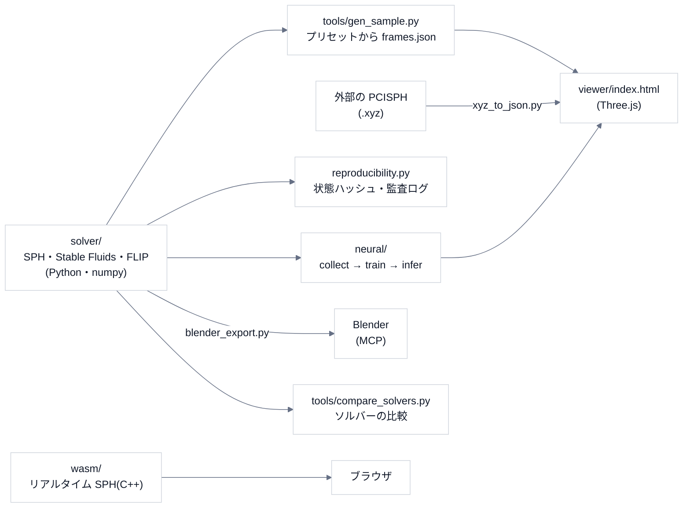

# 1. 全体像

## 6 フェーズのパイプライン

| フェーズ | 何をするか | 主な場所 |
|---|---|---|
| 1 | Python の SPH で `frames.json` を作る | `tools/gen_sample.py`・`solver/` |
| 2 | Three.js の Viewer で見る(インストール不要) | `viewer/index.html` |
| 3 | 外部の高精度 PCISPH(`.xyz`)を `frames.json` に変換 | `tools/xyz_to_json.py` |
| 4 | Blender に取り込む(MCP) | `blender/`・`tools/blender_export.py` |
| 5 | WebAssembly のリアルタイム SPH | `wasm/`・`setup/download_build.py` |
| 6 | Neural Fluid(GNN)の学習と推論 | `neural/`・`utils.py` |

**この資料の範囲で動かして確かめたのは、フェーズ 1 のソルバー(`solver/`)とテスト・文書の検査**です。WebAssembly・Blender・GNN の学習は、ここでは実行していません(→ [テスト](05-testing.md))。

## 3 つのソルバー(流体の見方が違う)

| ソルバー | 見方 | データ | 得意 |
|---|---|---|---|
| `SPHSolver` | **粒子**(ラグランジュ) | `Particle` のリスト(位置・速度・質量) | 水しぶき・自由表面 |
| `StableFluids2D` | **格子**(オイラー) | `u`・`v`・`dens`(`(N+2)²` の配列) | 煙・染料の流れ |
| `FLIPSolver` | **粒子 + 格子** | `pos`・`vel` の配列 + `MACGrid` | 粒子の細かさと、格子の非圧縮性の両取り |

`step` の形が**ソルバーごとに違う**点に注意(`SPHSolver.step(particles, dt)`・`StableFluids2D.step()`・`FLIPSolver.step(pos, vel, gravity)` が `(new_pos, new_vel)` を返す)。`runner.py` の `solver.step()` は、**引数なしで状態配列を返す**形を前提にしている(→ [拡張](04-extend.md))。

## データの形

| もの | 形 | 作る場所 |
|---|---|---|
| Viewer の入力 | `{"metadata": {...}, "frames": [...], "speeds": [...]}`(`.json` か `.json.gz`) | `gen_sample.py`・`xyz_to_json.py` |
| 監査ログ | JSON: `timestamp`・`config_hash`・`numpy_version`・`random_seed`・`steps`(`step`・`state_hash`・`elapsed_ms`) | `SimulationRecord.save` |
| 状態の履歴 | NPZ(`step_00000` …・`config_hash`) | `SimulationRecord.save_npz` |
| 学習データ | NPZ(`collect_data.py`) | `neural/` |

## 設定値

| 名前 | 既定 | 範囲(`validate_config`) | 意味 |
|---|---|---|---|
| `N` | 64 | 8〜512 | 格子の 1 辺 |
| `dt` | 0.05 | 1e-5〜1.0 | 時間刻み |
| `visc` | 0.0 | 0〜10 | 粘性 |
| `n_frames` | 100 | 1〜2000 | ステップ数 |
| `seed` | 42 | 0〜 | 乱数のシード |

`SPHSolver` の既定: `smoothing_length` 0.1・`rest_density` 1000・`gas_constant` 2000・`viscosity` 0.1・重力 (0, −9.8)。プリセット(`gen_sample.py`)は `water_drop`・`smoke`・`splash`。

## やらないこと(範囲の外)

- **物理的に正確**な再現ではない。学習用の実装で、境界・圧力の扱いは簡略(カールノイズは、見た目用の近似)。
- **本格的な 3D の流体ではない**。`SPHSolver` の式は **2D 用**(カーネルの正規化係数が 2D)で、`gen_sample.py` は **3 次元の座標をそのまま渡して**使っている(空間ハッシュは x・y だけを見る)。見た目のために調整した値で動いている(→ [既知の問題](06-troubleshooting-maintenance.md))。
- 性能の数字(「47 倍」など)は、**書かれた時点の実測**。環境で変わる。
